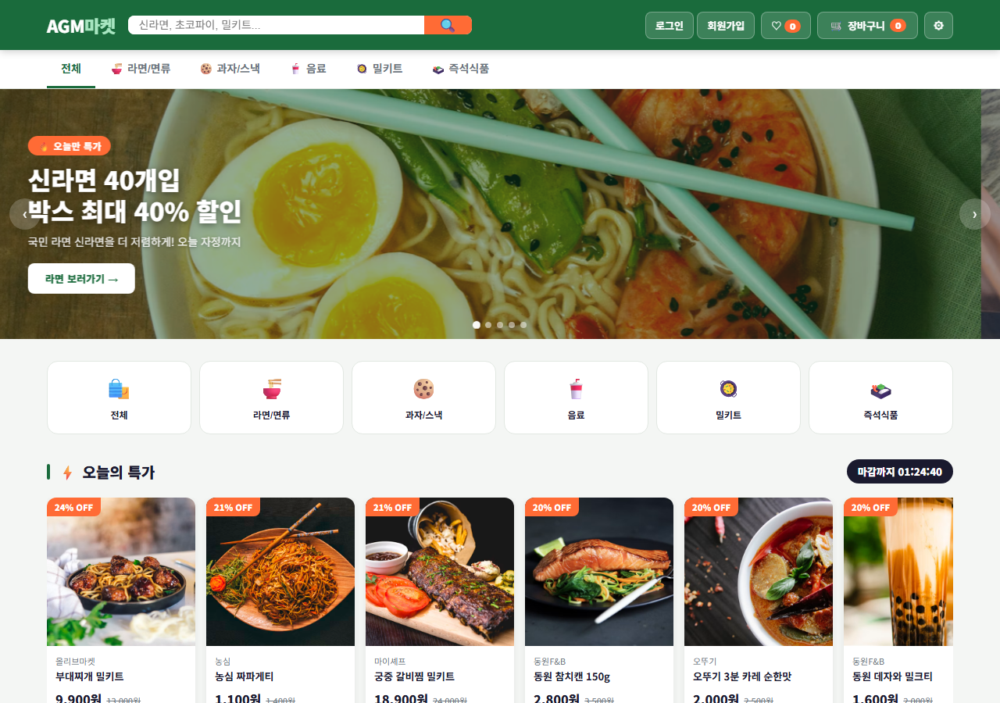
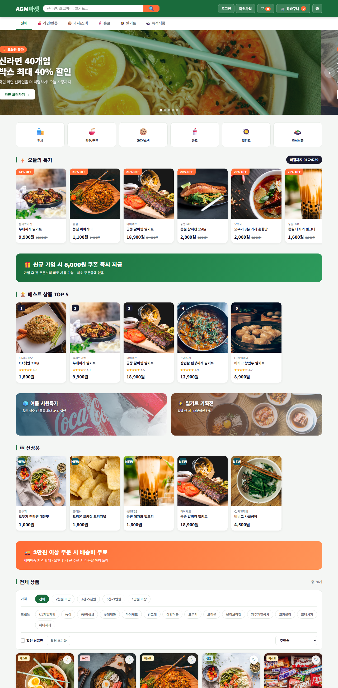
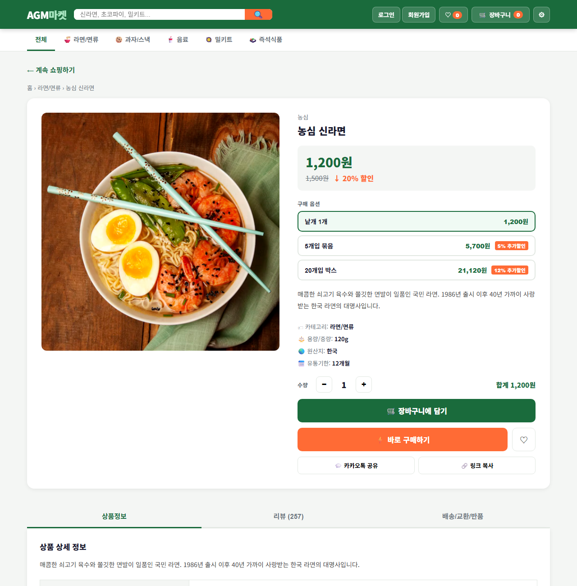
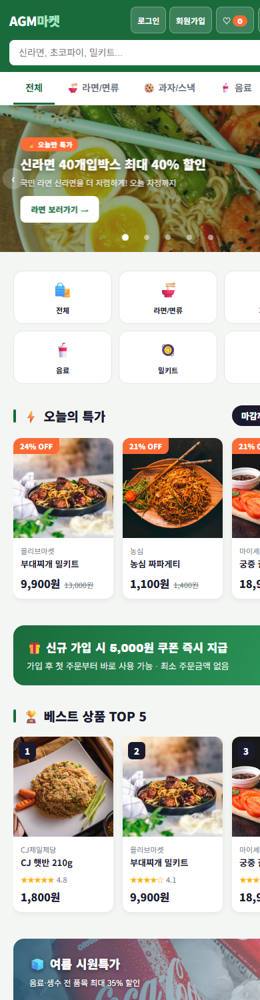
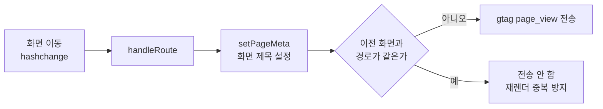
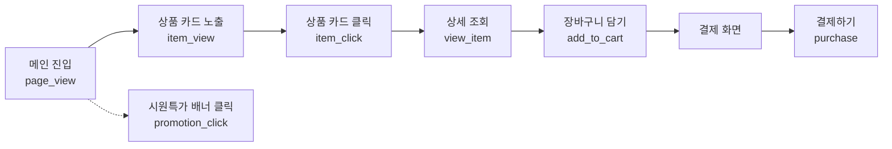
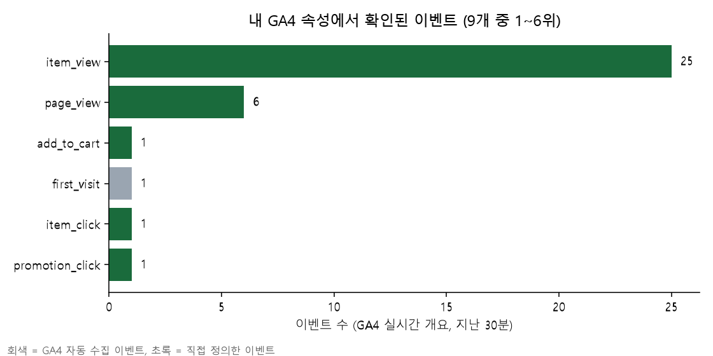

# AGM마켓 GA4 실습 프로젝트

가상의 신선식품 쇼핑몰 **AGM마켓**에 Google Analytics 4(GA4)를 설치하고, 이벤트를 설계해서 코드로 구현한 뒤, 실제 수집까지 확인한 실습 기록입니다.

- 배포 주소: https://jwoochoi2001.github.io/DA_AGM-Commerce/
- 원본 데모 쇼핑몰: 강사님 제공 프로젝트(`redskio/AGM-commerce`)를 바탕으로 했습니다.
- GA4 측정 ID: `G-YWY4DQH5XV` (내 GA 속성 `AGM Commerce`)

## 한눈에 보기

| 단계 | 내용 | 상태 |
|---|---|---|
| 1 | GA4 추적 코드 설치 | 완료 |
| 2 | 이벤트 설계서(택소노미) 기준 이벤트 구현 | 완료 |
| 3 | GA4 전자상거래 권장 규격(`items` 배열)에 맞추기 | 완료 |
| 4 | 화면 이동 시 `page_view` 직접 전송 (SPA 문제 해결) | 완료 |
| 5 | 내 GA 속성 생성, GitHub Pages 배포 | 완료 |
| 6 | GA4 실시간 개요에서 수집 확인 | 완료 |
| 7 | `section` 맞춤 측정기준 등록, 전자상거래 보고서 확인 | 진행 예정 |

## 사이트 화면

메인 화면입니다. 상단 배너, 카테고리, 오늘의 특가, 베스트, 신상품, 전체 상품, 최근 본 상품 영역이 있고, 이 영역 이름이 `section` 값이 됩니다.





상품 상세 화면입니다. 옵션(낱개, 5개입 묶음, 20개입 박스)과 수량을 고르고 장바구니에 담거나 바로 구매할 수 있습니다.



모바일 화면입니다.



## 1. GA4 설치

`docs/index.html`의 `<head>`에 GA4 태그를 넣었습니다.

```html
<!-- Google tag (gtag.js) -->
<script async src="https://www.googletagmanager.com/gtag/js?id=G-YWY4DQH5XV"></script>
<script>
  window.dataLayer = window.dataLayer || [];
  function gtag(){dataLayer.push(arguments);}
  gtag('js', new Date());
  // 첫 화면 포함 모든 page_view를 화면 이동 시점에 직접 보낸다(아래 4번 참고)
  gtag('config', 'G-YWY4DQH5XV', { send_page_view: false });
</script>
```

사이트와 GA는 별도의 연결 작업 없이 이어집니다. 방문자의 브라우저가 코드 안의 측정 ID로 GA에 데이터를 직접 보내기 때문입니다. 이 사이트에는 원래 강사님의 GTM 컨테이너(`GTM-5K4BTPKR`)도 붙어 있어서 함께 로드됩니다.

> 처음에는 수업 예시 ID(`G-20C08W3HCC`)를 넣었다가, 내 GA 계정과 속성을 새로 만든 뒤 내 ID로 교체했습니다.

## 2. 이벤트 설계와 구현

설계서(택소노미)에 정의한 이벤트를 모두 구현했습니다.

| no | 위치 | 발생 조건 | 이벤트 | 주요 파라미터 |
|---|---|---|---|---|
| 1 | 메인 | 여름 시원특가 배너 클릭 | `promotion_click` | `promotion_name` |
| 2 | 메인 | 상품 카드가 화면에 50% 이상 보일 때(카드당 1회) | `item_view` | `item_name`, `section`, `items` |
| 3 | 메인 | 상품 카드 클릭(상세로 이동) | `item_click` | `item_name`, `section`, `items` |
| 4 | 상품 상세 | 상세 페이지 조회 | `view_item` | `currency`, `value`, `items` |
| 5 | 상품 상세 | 장바구니에 담기 클릭 | `add_to_cart` | `currency`, `value`, `items`, `item_name`, `item_option` |
| 6 | 주문/결제 | 결제 화면의 결제하기 클릭 | `purchase` | `transaction_id`, `currency`, `value`, `shipping`, `coupon`, `items`, `item_name`, `item_option` |
| 7 | 전체 화면 | 화면(경로)이 바뀔 때 | `page_view` | `page_title`, `page_location`, `page_path` |

### 설계하면서 정한 기준

- **`item_view`는 화면에 실제로 보였을 때** 보냅니다. `IntersectionObserver`로 카드의 50% 이상이 보이면 카드당 한 번 보냅니다.
- **`item_click`은 상세로 이동하는 클릭만** 셉니다. 카드 안의 "장바구니 담기"와 찜 버튼은 제외했습니다.
- **`section`** 에는 영역 이름을 넣습니다: `오늘의 특가`, `베스트 상품`, `신상품`, `전체 상품`, `최근 본 상품`.
- **`purchase`는 결제하기 버튼 클릭 시점**에 보냅니다. 상세의 "바로 구매하기"는 결제 화면으로 이동만 하고 실제 주문은 결제하기에서 일어나기 때문입니다.
- **`value`는 옵션 단가 × 수량**입니다. `purchase`의 `value`에는 배송비와 쿠폰 할인을 넣지 않고, 배송비는 `shipping`으로 따로 보냅니다.
- 설계서의 모호한 부분(어느 상품 영역에 적용할지, 구매 시점, 금액 계산)은 하나씩 확인해서 정했습니다.

## 3. GA4 전자상거래 권장 규격 (`items` 배열)

`view_item`, `add_to_cart`, `purchase`는 GA4가 정의한 전자상거래 권장 이벤트입니다. 이 규격에 맞춰서 보내면 GA4가 구매 금액 등을 집계해서 전용 보고서와 그래프를 만들어 줍니다. 그래서 `currency`, `value`, `items[]`를 함께 보냅니다. 목록의 `item_view`, `item_click`에도 같은 `items`를 넣었습니다.

```js
// add_to_cart 예시: 5개입 묶음(5,700원) × 2개
gtag('event', 'add_to_cart', {
  currency: 'KRW',
  value: 11400,
  items: [{
    item_id: 'p01',
    item_name: '농심 신라면',
    item_category: '라면/면류',
    item_brand: '농심',
    item_variant: '5개입 묶음',
    price: 5700,
    quantity: 2
  }],
  item_name: '농심 신라면',     // 설계서의 사용자 정의 파라미터
  item_option: '5개입 묶음'
});
```

`purchase`는 주문 1건에 이벤트 1번을 보내고, 장바구니의 모든 상품을 `items`에 담습니다. 중복 집계를 막기 위해 `transaction_id`(주문번호)를 넣습니다.

| `items[]` 항목 | 값 |
|---|---|
| `item_id` | 상품 ID |
| `item_name` | 상품명 |
| `item_category` | 카테고리 |
| `item_brand` | 브랜드 |
| `item_variant` | 선택한 옵션명 |
| `price` | 옵션 1개 가격 |
| `quantity` | 수량 |
| `item_list_name` | (`item_view`, `item_click`만) 영역 이름 |

## 4. 화면 이동 시 `page_view` 문제 해결

### 문제

이 사이트는 한 페이지 안에서 화면을 바꾸는 구조(SPA)이고, 화면 주소는 `#/product/p01`처럼 `#` 뒷부분만 바뀝니다. GA4 기본 설정은 이런 화면 이동을 새 페이지 조회로 알아채지 못해서, `page_view`가 처음 한 번만 나갑니다. 그래서 "페이지 제목 및 화면 이름별 조회수"가 늘어나지 않습니다.

### 해결



1. GA 설정에 `send_page_view: false`를 넣어 자동 `page_view`를 끕니다. 켜 둔 채로 직접 보내면 첫 화면이 두 번 집계되기 때문입니다.
2. 화면이 바뀔 때마다 `page_view`를 직접 보냅니다. 같은 화면을 다시 그리는 경우는 보내지 않습니다.

### 로컬 테스트 결과

홈 → 상품 상세 → 장바구니 → 장바구니 다시 열기 → 홈 순서로 이동했을 때 `dataLayer`에 쌓인 `page_view`입니다.

| 순서 | `page_title` | `page_path` |
|---|---|---|
| 1 | AGM마켓 \| 신선식품 전문 온라인몰 | `/` |
| 2 | 삼양 불닭볶음면 \| AGM마켓 | `/product/p02` |
| 3 | 장바구니 \| AGM마켓 | `/cart` |
| 4 | AGM마켓 \| 신선식품 전문 온라인몰 | `/` |

장바구니를 다시 열었을 때는 중복 없이 한 번만 잡혔습니다.

## 5. 이벤트 흐름과 퍼널

사용자의 구매 흐름과 각 단계에서 나가는 이벤트입니다.



`view_item` → `add_to_cart` → `purchase` 세 이벤트가 구매 퍼널의 핵심 단계입니다. GA4에서는 탐색 → 퍼널 탐색 분석으로 단계별 이탈을 볼 수 있습니다.

## 6. 테스트 결과

### 로컬에서 확인한 이벤트 (`dataLayer`)

상품 카드를 눌러 상세로 들어가 `5개입 묶음`을 고르고 수량을 2로 올린 뒤 담고, 결제 화면에서 결제하기를 누른 결과입니다.

```json
["event","view_item",{"currency":"KRW","value":1200,"items":[{"item_id":"p01","item_name":"농심 신라면","item_category":"라면/면류","item_brand":"농심","item_variant":"낱개 1개","price":1200,"quantity":1}]}]

["event","add_to_cart",{"currency":"KRW","value":11400,"items":[{"item_id":"p01","item_name":"농심 신라면","item_variant":"5개입 묶음","price":5700,"quantity":2}],"item_name":"농심 신라면","item_option":"5개입 묶음"}]

["event","purchase",{"transaction_id":"AGM-1792409537775","currency":"KRW","value":22800,"shipping":3000,"coupon":"","items":[{"item_id":"p01","item_name":"농심 신라면","item_variant":"5개입 묶음","price":5700,"quantity":4}],"item_name":"농심 신라면","item_option":"5개입 묶음"}]
```

(위 `purchase`의 수량 4는 같은 장바구니에 담기와 바로 구매를 모두 눌러서 합쳐진 값입니다. 계산 방식은 옵션 단가 × 수량으로 맞습니다.)

목록 이벤트에는 영역 이름이 같이 나갑니다.

```json
["event","item_click",{"item_name":"CJ 햇반 210g","section":"베스트 상품","items":[{"item_id":"p17","item_name":"CJ 햇반 210g","item_variant":"1개","price":1800,"quantity":1,"item_list_name":"베스트 상품"}]}]
```

### GA4 실시간 개요에서 확인한 수집 결과

배포된 사이트를 직접 사용한 뒤 내 GA 속성의 실시간 개요에서 본 이벤트입니다. (9개 중 1~6위)



| 이벤트 | 수 | 의미 |
|---|---|---|
| `item_view` | 25 | 상품 카드 노출 |
| `page_view` | 6 | 화면 이동 |
| `add_to_cart` | 1 | 장바구니 담기 |
| `first_visit` | 1 | GA4 자동 수집(첫 방문) |
| `item_click` | 1 | 상품 클릭 |
| `promotion_click` | 1 | 시원특가 배너 클릭 |

- 활성 사용자 1명, 국가는 South Korea로 잡혔습니다. 사이트를 직접 사용한 본인이 집계된 것입니다.
- `page_view`가 화면 이동 횟수만큼 올라와서, 앞서 본 "조회수가 늘지 않는 문제"는 해결된 것을 확인했습니다.
- 나머지 3개 이벤트(`view_item`, `purchase` 등)는 실시간 개요의 다음 페이지에서 확인합니다.

## 7. 시행착오와 확인한 점

- **데모 계정과 내 계정을 헷갈렸습니다.** 처음 실시간 화면에 `view_item_list`, `top_spenders` 같은 이벤트가 떴는데, 이건 GA 데모 계정의 샘플 데이터였습니다. 내 속성이 아직 없어서 계정과 속성을 새로 만들었습니다.
- **측정 ID를 교체했습니다.** 수업 예시 ID가 아니라 내 속성의 ID(`G-YWY4DQH5XV`)로 바꾸고 다시 배포했습니다.
- **홈 보고서의 "데이터가 없다"는 안내**는 반영이 늦어서 나오는 문구입니다. 실시간 개요의 사용자 수가 실제 수집 확인입니다.
- **같은 화면을 다시 그릴 때 `page_view`가 중복될 수 있는 점**을 막기 위해 직전 경로와 비교하도록 했습니다.

## 8. 앞으로 할 일

- [ ] GA4에서 `section`을 **맞춤 측정기준**으로 등록(관리 → 맞춤 정의 → 이벤트 범위, 이벤트 매개변수 `section`). 등록 후 쌓이는 데이터부터 영역별 분석이 가능합니다.
- [ ] 다음 날 전자상거래 구매 보고서에서 `purchase` 금액과 상품 정보 집계 확인
- [ ] 참여도 보고서에서 화면 이름별 조회수 확인
- [ ] 탐색에서 퍼널 탐색 분석(`view_item` → `add_to_cart` → `purchase`) 만들기
- [ ] GA4 → BigQuery 연동 후 이벤트·세션·상품 단위 표로 펼쳐서 분석

## 프로젝트 구조

| 경로 | 설명 |
|---|---|
| `docs/index.html` | GitHub Pages로 배포되는 사이트(GA4 코드와 이벤트 포함) |
| `public/index.html` | 서버(`server.js`) 실행용 사이트 파일 |
| `readme-assets/` | README에 쓴 화면 캡처와 차트 |

## 로컬에서 실행

```bash
cd docs
python -m http.server 8766
# http://localhost:8766
```

로컬 접속도 GA로 데이터가 전송되므로, 테스트할 때 내 속성의 실시간 데이터에 섞일 수 있습니다.
